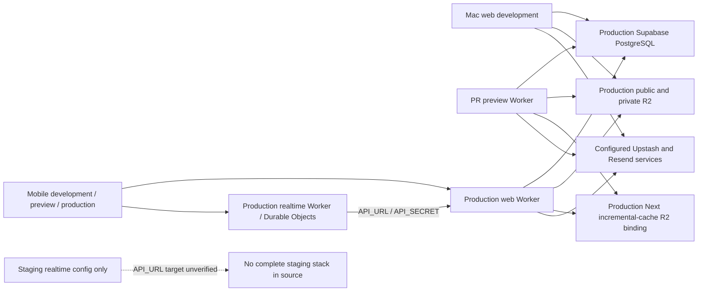

# Environment dependency and isolation audit

This document preserves the Phase 1 source snapshot. See the current
[implementation and verification status](environment-isolation-implementation.md)
for changes made after the audit.

Audit date: **1 November 2026 (Asia/Kolkata)**. Source revision:
`48215d4f0d6ef724bc058f51ca5f22caaf1e3b9a` (`main`, also confirmed on origin).
Scope: **Phase 1 only**. The result is documentation for review; environment
isolation has **not** been implemented. See the
[proposed implementation plan](environment-isolation-plan.md) and
[variable inventory](environment-variable-inventory.md).

## Assessment

**Development and PR previews can currently reach production data and services.**
Staging is incomplete, and production deployment has no explicit approval gate
in its workflow. Keep Supabase PostgreSQL authoritative during isolation work.
The current app has no D1 adapter or D1 binding; provisioning D1 alone cannot
provide its database functionality.

No infrastructure, application code, workflow, local secret file, database,
bucket, namespace, domain, or deployment was changed by this audit. No seed,
cleanup, migration, credential write-probe, push, email, load test, or application
server was run. Secret values were inspected locally only as necessary to
identify configuration and compare copies; none are included in these documents.

## Evidence and access limits

| Evidence | Result and limit |
| --- | --- |
| Tracked source, all four workflows, package scripts, Wrangler/OpenNext, Supabase and mobile configuration | Inspected at the revision above. References below use repository paths and source line numbers. |
| Ignored environment files in this checkout | Inspected variable names, configured hosts, bucket names, presence and equality of copies. A configured credential is not proof that it is still valid. |
| GitHub public repository metadata, read-only API | Repository is public; all four checked-in workflows are active. Environments `Preview`, `Preview – uxcommunity`, and `Production` each report `protection_rules: []` and no deployment branch policy. Repository ruleset listing is empty. |
| GitHub secret metadata and classic main-branch protection | Requests returned HTTP 401; `gh` is unauthenticated. Secret scopes/values, classic branch protection, and historical run artifacts were not verified. The connected GitHub tool can read this PR, but write attempts return HTTP 403 and it does not expose those administration endpoints. |
| Cloudflare live inventory, GET requests only | Saved Wrangler OAuth credential expired on 30 October 2026. Inventory requests returned HTTP 401; other requests in the same read-only batch returned HTTP 429. Stopped without refresh or retry. Live Worker bindings, DO namespace IDs, buckets, D1 databases, routes, schedules, deployments and token policies remain unverified. |
| Supabase live project and production data | No database queries or management calls made. Current configuration and the committed 31 October schema artifacts were inspected. Those artifacts are historical evidence, not a new production check. |
| Vercel, Resend, Upstash, Firebase/Expo dashboards | No live account inventory obtained. Repository inspection identifies consumers; dashboard-side integration status, credentials and policies remain open items. |

The API responses and local environment contents have not been committed. The
report records redacted conclusions, not secrets or user data. This is not an
exhaustive Git-history or artifact secret scan.

## Current dependency map

This depicts configured connections and workflow intent. Local realtime URLs
currently point to localhost; the diagram does not imply that local DO state is
remote. The preview private bucket is **not configured by its workflow**, so
private upload functionality is incomplete rather than demonstrably isolated.

| Dependency | Development today | Staging / preview today | Production source configuration |
| --- | --- | --- | --- |
| Web/API | `next dev` reads ignored web environment files | Per-PR Worker created from production config; no staging web config | `uxcommunity-web`; `https://app.uxcommunity.in` |
| Database | Production Supabase URL and service-role credential configured | Preview uses same URL and repository secret; dedicated staging DB not established in source | Supabase project URL ending in `eauupthwlnarkauwifmw.supabase.co`; service-role access |
| Public media R2 | `drafthub`, public base `https://media.uxcommunity.in` | Preview copies repository media credentials and bucket secret | S3 client configured through `R2_*`; live values not retrieved |
| Private media R2 | `uxcommunity-private`, same S3 credential as public media | Preview omits `R2_PRIVATE_BUCKET_NAME`; no staging private bucket config | Private bucket required by production deploy workflow |
| Next incremental cache | Worker preview can simulate binding locally; plain `next dev` does not by itself make media local | Per-PR deploy retains `uxcommunity-web-next-cache` binding | `NEXT_INC_CACHE_R2_BUCKET` → `uxcommunity-web-next-cache` |
| Realtime / DO | `.dev.vars` targets local web API; web realtime URLs point to localhost | Separate realtime config exists with `Room` / `UserDO`; no deployed namespace proof | `uxcommunity-realtime`, `Room` / `UserDO` / `AlertMonitor`; public realtime URL `https://rt.uxcommunity.in` |
| Internal Worker calls | Matching local `API_SECRET`, session and publish secrets | Staging `API_URL`/secret provenance unknown; preview omits server publish secrets | Realtime `API_URL` → web membership/session and scheduled endpoints |
| Redis / rate limits | Configured remote Upstash URL and token | Preview copies same repository secrets | Shared consumer uses Upstash REST; live scope unknown |
| Email | Resend key, sender and production app URL configured | Preview copies same key/sender; no recipient restriction | Resend transactional and health-alert emails |
| Push | Uses tokens in whichever DB is configured; Expo transport needs no FCM secret | No nonproduction transport kill switch or recipient allowlist | Direct FCM plus Expo fallback, token/receipt cleanup in DB |
| Cron | Local manual scheduled testing can call configured API | Staging config has no triggers; manual internal calls remain possible | Every minute: lifecycle push and verification email; every 5 min: dependency monitor; every 6 hours: destructive chat retention |
| Mobile | Ignored `.env` targets production API and realtime | EAS development and preview profiles both target production API | Same static app identifiers/Firebase configuration and EAS project; production API profile |
| D1 | No app implementation | No app implementation or binding | No app implementation or binding; PostgreSQL remains authoritative |

## Findings

### F01 — Critical: PR previews receive production credentials

[`.github/workflows/preview.yml`](https://github.com/sachin1228/uxcommunity/blob/48215d4f0d6ef724bc058f51ca5f22caaf1e3b9a/.github/workflows/preview.yml#L23) runs on
PR open/synchronize/reopen and only skips deploy when the PR has `skip-preview`.
It copies the production `[vars]`, service-role DB key, `SESSION_SECRET`, admin
credentials, Resend, Upstash and R2 secrets into a new Worker (lines 47–85).
Comments at lines 88–106 explicitly acknowledge production media and services.
The R2 credential guard performs **PUT / GET / DELETE**, so merely running this
workflow can write to production R2 before a preview is used. The per-PR Worker
name does not isolate credentials, database, cache or service bindings.

### F02 — Critical: local app configuration targets production

Ignored files `apps/web/.env.local` and `apps/web/.dev.vars` configure the
production DB and public media host, remote Upstash, live-service credential
slots, production app URL, public/private bucket names and admin credentials.
All 23 parsed keys match between these two files. There is also a secret-bearing
`.dev.vars.bak-20261030151132` backup. The realtime and web local files share
session, internal API and publish secret values with each other; equality with
live production secrets could not be verified.

`apps/web/.env.production.local` embeds production public URLs for local builds.
`supabase/.temp/project-ref` exists and matches the production project in the
web configuration. These files are ignored by Git, but ignoring them does not
prevent runtime production access. Do not run development, seeders or migrations
with this configuration while it remains in place.

### F03 — High: storage and cache require separate isolation work

[`lib/r2.ts`](https://github.com/sachin1228/uxcommunity/blob/48215d4f0d6ef724bc058f51ca5f22caaf1e3b9a/apps/web/lib/r2.ts#L122) always constructs an AWS S3 client with
`https://<account>.r2.cloudflarestorage.com`. Wrangler's local R2 simulation does
**not** intercept this HTTP client. Private media reuses the client in
[`r2-private.ts`](https://github.com/sachin1228/uxcommunity/blob/48215d4f0d6ef724bc058f51ca5f22caaf1e3b9a/apps/web/lib/r2-private.ts#L25). Both need a deliberate local
adapter, including direct uploads and private downloads.

[`wrangler.toml`](https://github.com/sachin1228/uxcommunity/blob/48215d4f0d6ef724bc058f51ca5f22caaf1e3b9a/apps/web/wrangler.toml#L30) also binds a self-reference to
`uxcommunity-web` and the cache bucket `uxcommunity-web-next-cache` (line 48).
Preview only overrides the Worker name; these configured targets remain
production targets. The cache is a third bucket to isolate alongside public
and private media. Actual deployed preview bindings need authenticated review.
[`scripts/r2-cors.json`](https://github.com/sachin1228/uxcommunity/blob/48215d4f0d6ef724bc058f51ca5f22caaf1e3b9a/scripts/r2-cors.json) includes production origins and
a wildcard Workers preview origin; deployed CORS must be inspected separately.

### F04 — High: there is no complete staging stack

[`apps/realtime/wrangler.staging.toml`](https://github.com/sachin1228/uxcommunity/blob/48215d4f0d6ef724bc058f51ca5f22caaf1e3b9a/apps/realtime/wrangler.staging.toml)
names `uxcommunity-realtime-staging`, binds `Room` and `UserDO`, and has migration
tags v1–v3. Separate Worker identity is a useful basis for separate DO storage;
binding class names being equal does not mean namespaces are shared. However,
the live namespaces, secret values, `API_URL`, routing and deployment revision
are unverified. This config omits the current `AlertMonitor` binding/v4 migration
and has no cron triggers, unlike the production config.

No staging web config, DB project identity, media/cache buckets, domain mapping,
secret manifest or deploy workflow is present. Older staging-named diagnostic
scripts and the disposable PostgreSQL 17.6 schema comparison are **not** proof
of a running isolated application environment. The old realtime config should
be reconciled before use; do not redeploy it blindly over a live Worker.

### F05 — High: mobile test builds use production

[`eas.json`](https://github.com/sachin1228/uxcommunity/blob/48215d4f0d6ef724bc058f51ca5f22caaf1e3b9a/expo-app-standalone%203/eas.json) sends development, preview and
production builds to `https://app.uxcommunity.in`. The ignored mobile `.env`
also points to production realtime. API and realtime environment variables are
read separately, so changing one can leave a mixed environment. Static
[`app.json`](https://github.com/sachin1228/uxcommunity/blob/48215d4f0d6ef724bc058f51ca5f22caaf1e3b9a/expo-app-standalone%203/app.json) defines one app identity per OS,
one scheme, one Firebase configuration and one EAS project.

[`sessionStorage.ts`](https://github.com/sachin1228/uxcommunity/blob/48215d4f0d6ef724bc058f51ca5f22caaf1e3b9a/expo-app-standalone%203/lib/sessionStorage.ts) and mobile
push storage use fixed keys. Builds need separate app identities and environment
storage keys so a test client cannot reuse production sessions or device state.

### F06 — High: disabling realtime publishing does not isolate previews

The preview workflow omits `REALTIME_URL` and `REALTIME_PUBLISH_SECRET`, so
[`publish.ts`](https://github.com/sachin1228/uxcommunity/blob/48215d4f0d6ef724bc058f51ca5f22caaf1e3b9a/apps/web/lib/realtime/publish.ts#L29) will skip server publish.
However it copies `NEXT_PUBLIC_REALTIME_URL` from production into the browser
bundle. A browser can attempt to connect to production realtime; membership
and session validity determine whether it succeeds. Its REST writes already
go to production DB regardless of realtime publishing.

[`cookie-domain.ts`](https://github.com/sachin1228/uxcommunity/blob/48215d4f0d6ef724bc058f51ca5f22caaf1e3b9a/apps/web/lib/auth/cookie-domain.ts#L15) assigns
`.uxcommunity.in` to **any** matching subdomain. A staging domain under that
parent would receive production cookies, and can overwrite cookies under the
current name/domain policy. Distinct signing keys alone do not prevent cookie
disclosure or collisions. Staging needs a narrower cookie domain/name and a
plan for the existing production parent cookie, or a separate registrable domain.

### F07 — Critical: push and email have no environment delivery boundary

[`push/expo.ts`](https://github.com/sachin1228/uxcommunity/blob/48215d4f0d6ef724bc058f51ca5f22caaf1e3b9a/apps/web/lib/push/expo.ts#L394) sends directly to Expo with
device tokens and no provider credential header. Missing `FCM_SERVICE_ACCOUNT`
is therefore **not** a push-off switch. Chat, DM and activity senders can fall
back to Expo; membership and `/api/push/test` also send. Recipient token reads
and dead-token/receipt cleanup use the configured DB. With shared production
DB access, a preview action can notify real users or mutate their token rows.

[`email/index.ts`](https://github.com/sachin1228/uxcommunity/blob/48215d4f0d6ef724bc058f51ca5f22caaf1e3b9a/apps/web/lib/email/index.ts#L47) sends to its supplied
recipient with the configured Resend key. There is no nonproduction recipient
restriction or capture mode. Password reset, signup, verification, moderation,
account deletion and health alerts require isolation as well as cron emails.

### F08 — High: cron isolation must include internal API calls

[`apps/realtime/wrangler.toml`](https://github.com/sachin1228/uxcommunity/blob/48215d4f0d6ef724bc058f51ca5f22caaf1e3b9a/apps/realtime/wrangler.toml#L63) declares
three schedules. [`src/index.ts`](https://github.com/sachin1228/uxcommunity/blob/48215d4f0d6ef724bc058f51ca5f22caaf1e3b9a/apps/realtime/src/index.ts#L122) dispatches
them through `API_URL` / `API_SECRET`. Retention deletes old DB messages and R2
objects; minute jobs can send push/email. Internal routes authenticate a shared
secret but do not assert environment identity. A staging Worker with production
API URL/secret can trigger production operations even without its own DB key.
The existing staging config omits triggers, which reduces scheduled activity
but does not protect manual calls or a misconfigured future schedule.

### F09 — High: production deployment does not require explicit approval

[`.github/workflows/deploy.yml`](https://github.com/sachin1228/uxcommunity/blob/48215d4f0d6ef724bc058f51ca5f22caaf1e3b9a/.github/workflows/deploy.yml#L18) deploys
both production Workers on every main push and allows manual dispatch from a
selected ref. The job has no `environment:` approval gate or main-ref condition
on manual runs. Live GitHub `Production` environment metadata also has no
protection rules, and the workflow does not reference it. Classic branch
protection is unverified and cannot substitute for deployment approval.

Workflow references use the same secret names in production and previews,
without an environment declaration separating access. Cloudflare token scopes
and the live secret inventory remain unknown. `--keep-vars` and secret pushes
preserve unmentioned values; source inspection alone cannot establish the live
Worker configuration. Secret pushes happen after code deployment, creating a
mixed-configuration window that the rollout plan must address.

### F10 — High: DB tooling protections are incomplete outside fresh tests

Useful existing foundations are the pinned CLI, schema-only baseline,
[`test_fresh.py`](https://github.com/sachin1228/uxcommunity/blob/48215d4f0d6ef724bc058f51ca5f22caaf1e3b9a/scripts/db/test_fresh.py#L43) using an unlinked temporary
workdir and sanitized credentials, and the loopback/identity checks in
[`initialize.py`](https://github.com/sachin1228/uxcommunity/blob/48215d4f0d6ef724bc058f51ca5f22caaf1e3b9a/scripts/db/initialize.py#L90). Database CI uses disposable
Supabase instances without production secrets. These can be reused.

However [`cli.sh`](https://github.com/sachin1228/uxcommunity/blob/48215d4f0d6ef724bc058f51ca5f22caaf1e3b9a/scripts/db/cli.sh) validates filenames and then forwards
arbitrary CLI arguments; it does not prohibit remote link/push/reset/repair.
The ignored production link increases this risk. The existing
[adoption documentation](database-adoption-review.md) requires separate approval
and backups; it is not a runtime approval gate. There is no automated production
migration job today. Preserve that separation; never apply the fresh baseline
to existing production during this task.

### F11 — High: maintenance/test tools can bypass target intent

`k6/scripts/seed-users.js` and `cleanup-users.js` accept arbitrary supplied DB
URLs; cleanup deletes matching users and cascading records. The E2E
[`seed-member.mjs`](https://github.com/sachin1228/uxcommunity/blob/48215d4f0d6ef724bc058f51ca5f22caaf1e3b9a/apps/web/e2e/seed-member.mjs#L134) refuses remote hosts by
default but permits **any** remote target with `E2E_SEED_ALLOW_REMOTE=1`.
[`assertStagingTarget`](https://github.com/sachin1228/uxcommunity/blob/48215d4f0d6ef724bc058f51ca5f22caaf1e3b9a/k6/lib/realtime-fanout.mjs#L157) accepts any Workers
subdomain or host containing `staging`/`localhost`, with an additional override.
A production Workers URL can pass that heuristic.

Other write paths include the admin load-test launcher, company description
seeding, company imports/logo mirroring, city image upload, and private-R2
apply/purge tooling. Several scripts load the ignored web env files themselves.
Give every writer explicit target validation; a `dry-run` flag or test-looking
email does not prove environment identity. Staging diagnostic scripts also
contain published signing/publish literals (not matching the current local
values); remove literal fallbacks and retire/rotate any deployed use after
review. They were not used in this audit.

### F12 — Medium: cache, fallback and operator guidance can cross boundaries

Upstash uses the configured remote credential with no environment prefix in the
app's limiter keys. Missing/unavailable Redis fails open
([`rate-limit.ts`](https://github.com/sachin1228/uxcommunity/blob/48215d4f0d6ef724bc058f51ca5f22caaf1e3b9a/apps/web/lib/auth/rate-limit.ts#L63)); it does not establish
a safe local limiter. Next cache keys likewise rely on bucket/runtime isolation.
Session, master-data and client caches also need environment separation where
state can persist across builds/accounts.

The Supabase and R2 clients throw on missing required settings, which is useful,
but accept production settings in any runtime. There is no `APP_ENV` identity
guard. The FCM token-cache key and some application link metadata have production URL
fallbacks. The FCM URL is a cache key, not an outbound API fallback; link
metadata still needs explicit environment configuration. Root
README setup/credential-rotation instructions currently encourage matching local
files to repository production credentials. No tracked `.env.example` or
complete nonproduction setup manifest was found.

## Verification status against mandatory requirements

| Requirement | Phase 1 result |
| --- | --- |
| Local/staging never target production DB | **Fails in configuration:** local and PR preview do; dedicated staging remains unverified. |
| Separate R2 buckets | **Fails for previews:** media credentials and cache binding reused; local media uses remote S3 endpoint. |
| Separate DO namespaces | **Partly represented in config; not proven live.** Local runtime and staging Worker names are distinct; deployed namespace IDs need review. |
| No production secrets in previews | **Fails in workflow.** |
| Cron disabled or isolated in staging | Staging TOML has no triggers; live schedules and manual-call isolation unverified. |
| No staging push to real users | **No enforceable boundary found.** Shared DB/Expo paths are unsafe. |
| Independent DB migrations | Disposable DB CI supports this; app environments and remote migration approval are incomplete. |
| Explicit production deployment/migration approval | Deployment **fails**; migration approval exists in prose only, no production migration automation. |
| Production stays operational, no production data changes | Audit performed no deploy or application/data writes. Live availability/functional health not tested. |
| Local/staging uploads, realtime, cron, push, web and mobile E2E | Deferred to Phase 5 after safe environments exist; no passing isolation claim. |

Documentation validation completed locally: repository comment/path audit passed;
Vercel drift audit passed (five rules); added Markdown targets and source line
anchors resolved; whitespace checks passed; credential-pattern checks and direct
comparison against configured private values found no copied secrets. The
comment audit reports three existing stale exemptions as informational output.
Application, database and browser/device tests were not run for this
documentation-only change. CI is intentionally skipped for the PR safety reason
below, so these local checks are the validation evidence for this audit.

## Review and PR handling

This audit PR must not launch the unsafe preview pipeline. Its commits use
`[skip ci]` so opening the PR cannot race ahead of a label. When opening the PR,
apply `skip-preview` as a second guard. Draft status alone does not skip this workflow.
[GitHub's documented skip behavior](https://docs.github.com/en/actions/how-tos/manage-workflow-runs/skip-workflow-runs)
covers push/pull-request events; it can leave required checks pending. Do not
remove the marker, push a new unguarded commit, or manually dispatch deploy jobs
to work around pending checks. Closing this PR can still invoke the existing
cleanup job, which uses the production Cloudflare token to delete a per-PR
Worker. That behavior has not been changed by this documentation-only PR.

The [next-phase plan](environment-isolation-plan.md) supplies concrete resources,
order, approval boundaries and verification criteria. Review that plan before
making the infrastructure changes requested in later phases.
